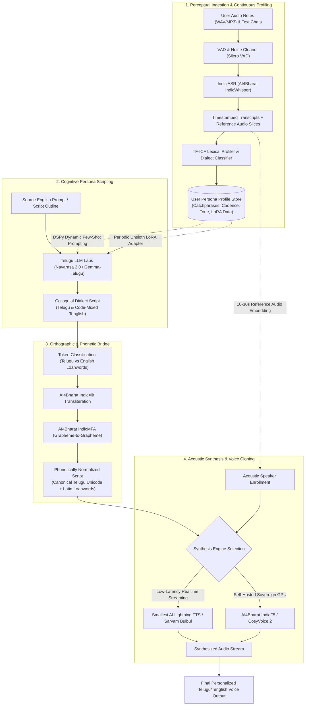

# Architecture & Pipeline Specifications: Yanthruda

## System Overview

**Yanthruda (యంత్రుడ)** is a specialized composite AI architecture engineered to create authentic, continuous persona and voice clones in **Telugu and Romanized Tenglish** (Telugu written phonetically using Latin/English characters), with cross-lingual support for Hindi/Hinglish.

Unlike generic voice-cloning or translation solutions, Yanthruda decouples **Persona Discovery**, **Cognitive Scripting**, **Orthographic Normalization**, and **Acoustic Speech Synthesis** into specialized modular sub-systems.

---

## High-Level Architecture Diagram



---

## Detailed Component Specifications

### 1. Perceptual Ingestion & Continuous Profiling
- **Voice Ingestion**: Accepts continuous or episodic user voice recordings (monologues, voice notes, conversations).
- **VAD & Segmentation**: Utilizes `Silero VAD` to filter out silence, breaths, and ambient background noise, slicing audio into coherent 3–15 second chunks.
- **Diarization & Alignment**: Uses `PyAnnote Audio` to isolate user-only audio tracks in conversational settings.
- **Indic Automatic Speech Recognition (ASR)**: Employs [`IndicWhisper`](./research/results/IndicWhisper_Lexicon_Extraction_Framework.json), fine-tuned on AI4Bharat's Vistaar/Kathbath dataset (1,680+ hours across 203 Indian districts).
- **Lexical Mining Engine**:
  - Computes **Term Frequency - Inverse Corpus Frequency (TF-ICF)** comparing the user’s personal transcripts against standard formal Coastal Andhra corpora.
  - Automatically isolates and ranks regional slang:
    - *Telangana:* `gatla`, `kirrak`, `dhaawat`, `paisal`, `endi bro`, `yaadiki`
    - *Rayalaseema:* `mande`, `dhabba`, `endappa`, `alla`
  - Captures conversational discourse markers: `kadaa`, `antey`, `mari`, `le`, `boss`, `kadhe`.
  - Computes personal speech tempo ($WPM$) and fundamental pitch frequency distribution ($F_0$).

---

### 2. Cognitive Persona Scripting
- **Base LLM**: [`Telugu LLM Labs Navarasa 2.0 / Gemma-Telugu (2B & 7B)`](./research/results/Telugu_LLM_Labs_Navarasa_2_0_Gemma-Telugu.json) or `Sarvam-1 (2B)`.
- **Token Efficiency**: Leverages an Indic-optimized SentencePiece vocabulary (token fertility of 1.6–2.4 tokens/word, compared to 6.0–9.0 in standard English LLMs), avoiding token blowout and corrupted character fragments.
- **Short-Term In-Context Adaptation**:
  - Uses `DSPy` teleprompters to inject user persona rules:
    ```
    System: You are an AI speaking as [User].
    Location & Regional Dialect: [Telangana / Hyderabad Colloquial]
    Key Catchphrases to inject naturally: [endi bro, kadaa, kirrak, gatla]
    Sentence Style: Casual, code-mixed Tenglish (30% English tech loanwords).
    ```
- **Long-Term Fine-Tuning**:
  - As user uploads surpass 500+ turns of text/audio, an automated `Unsloth` pipeline generates a lightweight (~50MB) LoRA adapter trained on consumer GPUs in under 30 minutes.

---

### 3. Orthographic & Phonetic Bridge (The Tenglish Solution)
- **The Core Problem**: Direct text-to-speech on raw informal Romanized Latin text (e.g., *"nenu repu morning office ki vastanu"*) causes conventional TTS engines to invoke English Grapheme-to-Phoneme (G2P) rules, producing an unintelligible, heavily anglicized accent.
- **The Solution Pipeline**:
  1. **Token Tagging**: Identifies native Telugu tokens versus genuine English loanwords (*office*, *meeting*, *bro*, *call*).
  2. **Transliteration via [`IndicXlit`](./research/results/AI4Bharat_IndicTrans2_IndicXlit.json)**: Maps Romanized Telugu tokens to native Telugu Unicode while leaving verified English loanwords in Latin script.
     - *Raw Input:* `nenu repu morning office ki vastanu bro`
     - *Normalized:* `నేను రేపు morning office కి వస్తాను bro`
  3. **Phonetic Alignment via [`IndicMFA`](./research/results/AI4Bharat_IndicMFA_G2G_Phonetic_Alignment.json)**:
     - Enforces Dravidian *ajanta* structure (words ending in vowels like `రాముడు` /ra:muɖu/), preventing unwanted Hindi-style schwa deletion.
     - Preserves retroflex plosive contrasts (`ట` vs `త`, `డ` vs `ద`) and geminate consonants (*vatthulu*).

---

### 4. Acoustic Synthesis & Voice Cloning
- **Voice Enrollment**: Extracts speaker embedding vectors from 10–30 seconds of high-SNR user audio clips selected during Stage 1.
- **Execution Paths**:
  - **Option A (Ultra-Low Latency Streaming API)**: [`Smallest AI Waves Lightning TTS`](./research/results/Smallest_AI_Waves_Platform_Lightning_TTS.json)
    - Time-to-First-Audio (TTFA): **<100ms**
    - Native support for intra-sentence code-switching between Telugu and English loanwords without pitch glitches.
  - **Option B (Sovereign Open-Source Self-Hosted)**: [`AI4Bharat IndicF5 & Indic Parler-TTS`](./research/results/AI4Bharat_IndicF5_Indic_Parler-TTS.json) / [`CosyVoice 2`](./research/results/Open-Source_Zero-Shot_Voice_Cloning_XTTS-v2_F5-TTS_CosyVoice.json)
    - 337M flow-matching diffusion transformer trained on 1,400+ hours of Indic speech data.
    - Zero external API dependencies; 100% data privacy for sensitive personal voice data.

---

## Directory Reference
- [Executive Mission Document (`docs/MISSION.md`)](./MISSION.md)
- [Comprehensive Deep Research Report (`docs/RESEARCH_REPORT.md`)](./RESEARCH_REPORT.md)
- [Research Framework & Raw Evaluations (`docs/research/`)](./research/)
